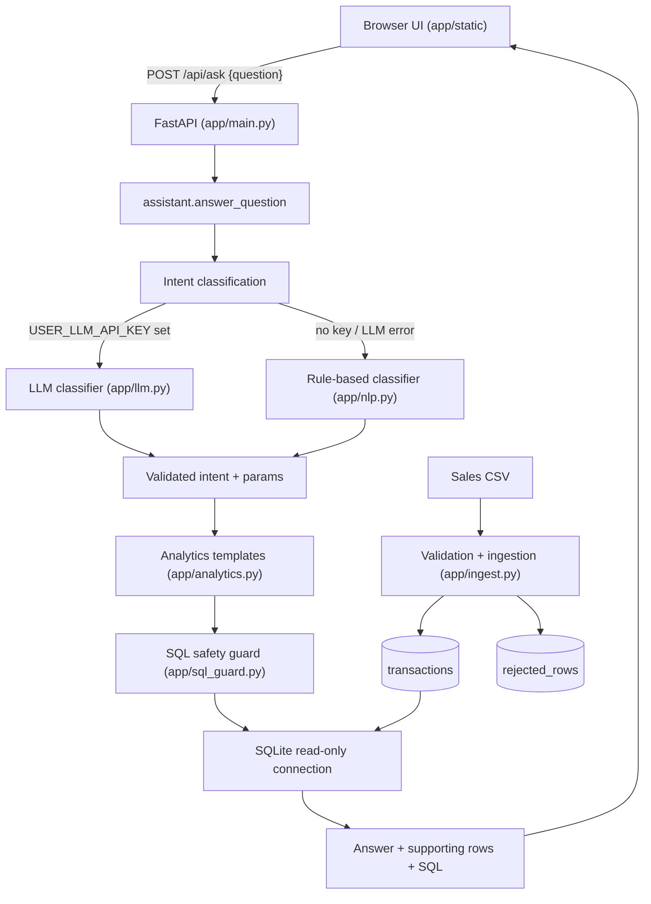

# Architecture

## Request flow

1. The UI sends the user's question to `POST /api/ask`.
2. `assistant.answer_question` turns the question into an **intent** plus
   parameters. It prefers the LLM classifier when a user key is configured and
   silently falls back to the deterministic rule-based classifier otherwise.
3. The intent selects a **pre-reviewed SQL template** from `analytics.py`. The
   LLM never writes SQL and user text never reaches the database.
4. `sql_guard.validate_sql` re-checks the resulting statement: single
   `SELECT`/`WITH` only, no comments, no multi-statements, no
   `INSERT/UPDATE/DELETE/DROP/ALTER/PRAGMA/ATTACH`, allow-listed tables only, and
   a forced `LIMIT`.
5. The query runs on a **read-only** SQLite connection. The answer, the
   supporting rows, the SQL, and the filters applied are returned together so
   the figure is always traceable.

## Load flow (offline, one-off)

`app/ingest.py` reads the CSV, validates every row, computes
`revenue = quantity * unit_price - discount_amount`, and writes valid rows to
`transactions`. Every invalid row is written to `rejected_rows` with a reason and
the raw payload instead of being dropped silently. The database is seeded at
startup if empty, or explicitly via `python3 -m scripts.seed`.
